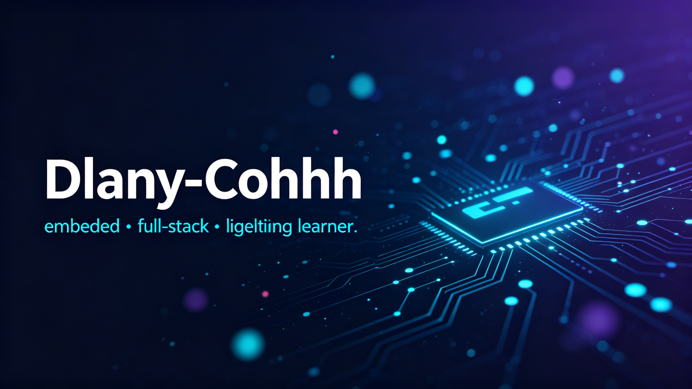
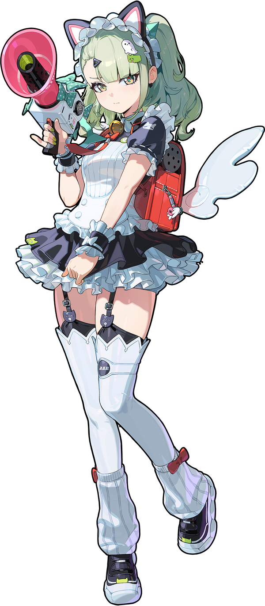

  

## Hi, I'm Dlany-Cohhh

*embedded systems · full-stack · lifelong learner*

 

### 📊 Stats

  
  

### 🛠 Tech Stack

 

### 🌱 Currently

- 🔧 Exploring embedded motor control & RC car projects
- 📚 Studying signals & systems and communications
- 🐍 Building Python automation tools and small utilities

  

